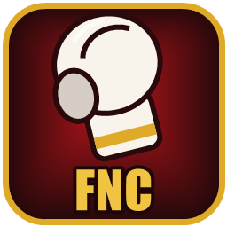
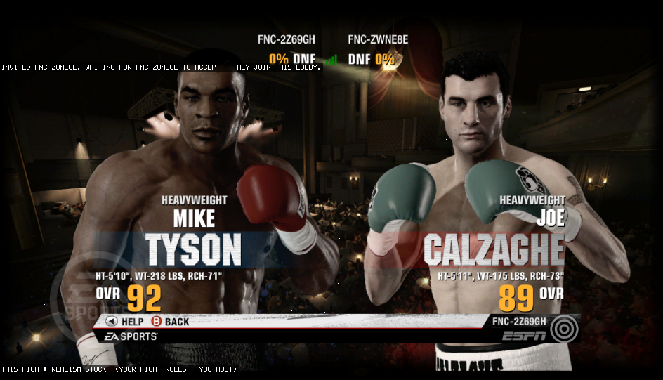
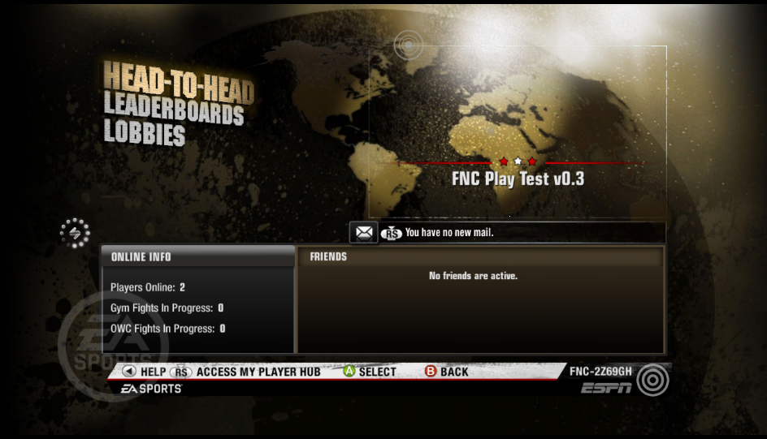
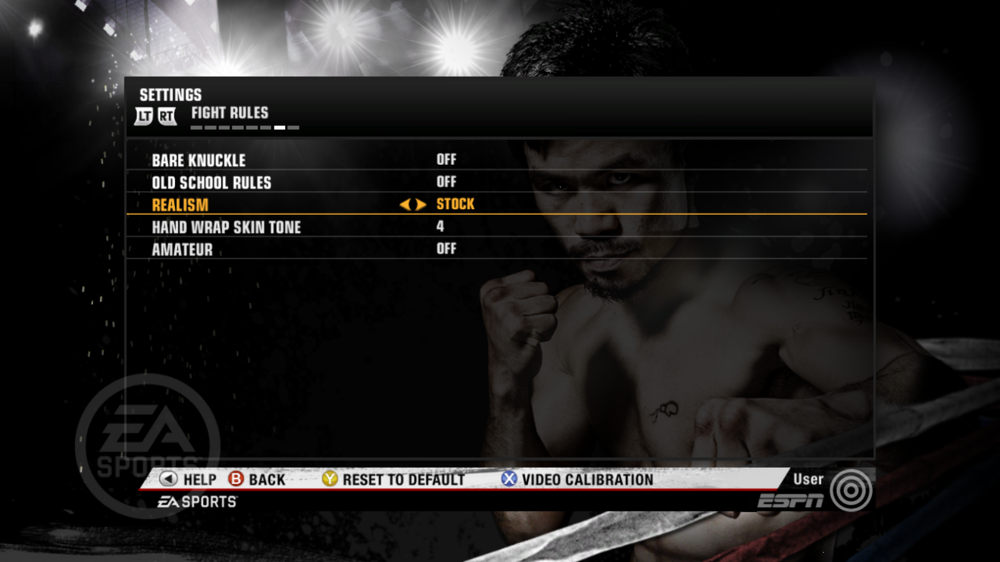
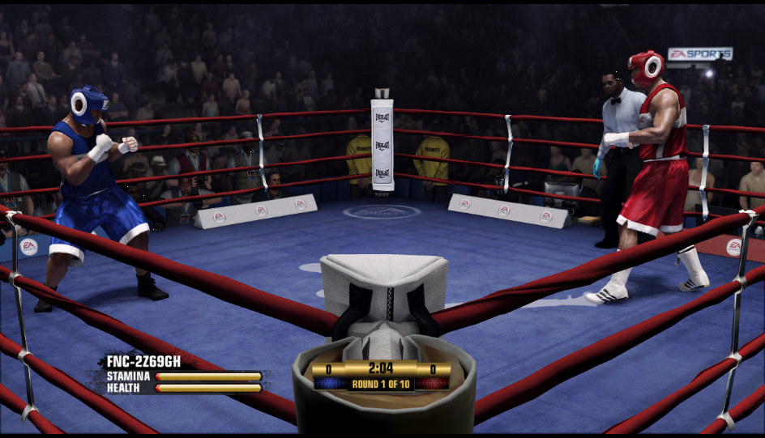
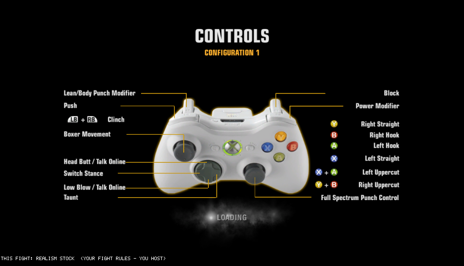
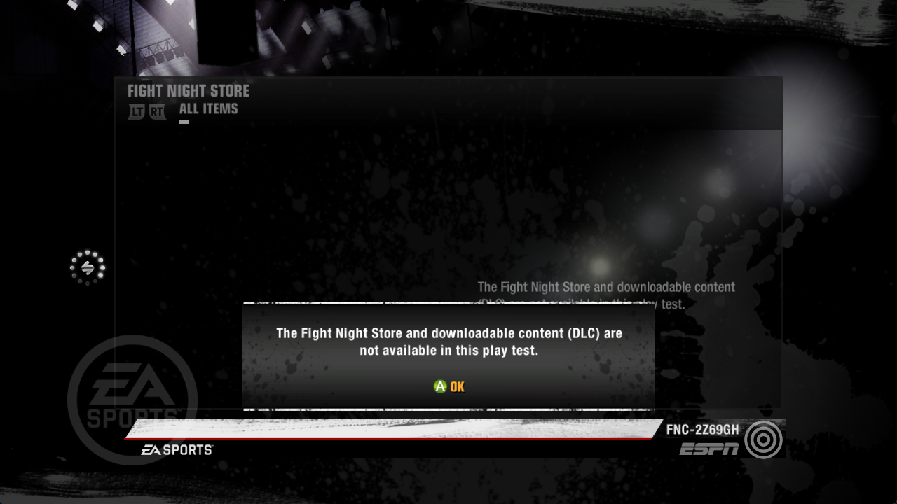

  

<h1 align="center">FNC Play Test - Fight Night Champion on PC</h1>

  

<b>The play test, help and the online community are on our Discord:
<a href="https://discord.gg/bnEhZwypW2">discord.gg/bnEhZwypW2</a></b>

A community play test that runs **Fight Night Champion** natively on Windows PCs - with new fight rules, PC display
and camera options, modding tools, and **online fights brought back on our own server**. You play from **your own
copy of the game**: the setup reads your Xbox 360 disc image once and builds the PC version from it.

> **Getting the build:** the play test is shared person to person inside our community - ask in
> **[our Discord](https://discord.gg/bnEhZwypW2)**. This page has no downloads and no game files.

**Current version: v0.3.2**

---

## Contents

- [Online play](#online-play)
- [Fight rules](#fight-rules)
- [Display and camera](#display-and-camera)
- [Fighter packs](#fighter-packs)
- [Modding and the fight inspector](#modding-and-the-fight-inspector)
- [Not in this play test yet](#not-in-this-play-test-yet)
- [What you need](#what-you-need)
- [Installing](#installing)
- [Reporting a problem](#reporting-a-problem)
- [Join the community](#join-the-community)
- [Versions](#versions)
- [Coming up](#coming-up)

---

## Online play

Main menu -> **ONLINE** -> **FIGHT NOW** -> **HEAD-TO-HEAD**

- **Ranked quick match, custom match and lobbies** - matchmaking on our own FNCNet server.
- **Play a Friend** - pick a player who is online and in the menus; they get an invite on screen (A accepts,
  B declines) and join your fight lobby.
- **No setup:** nobody types addresses and nobody opens router ports. Players on the same home network play
  directly; everyone else is introduced by the FNCNet server and, when a direct connection isn't possible, the fight
  is carried through the FNCNet relay. Nobody sees your address.
- **FNC ID and record:** every player gets an FNC ID on the first start, plus an online record - wins, losses and
  KOs. Leaving a fight early counts as a loss and the opponent gets the win.
- **The host's fight rules apply to both players**, so both PCs always run exactly the same fight. A line at the
  bottom of the screen shows which rules this fight uses.
- **Fair fights:** both PCs check every second that they are showing the same fight; a fight that splits apart counts
  as no contest instead of a win or loss.
- **Voice chat** in fights - hold D-pad Up or Down to talk.
- Online: licensed boxers in the same weight class (created boxers work offline), no fouls.

## Fight rules

Settings -> **FIGHT RULES** - for Play Now and online (online, the host's choice counts).

| Option | What it does |
|---|---|
| **Bare knuckle** | Wrapped fists instead of gloves - more cuts and damage. |
| **Hand wrap skin tone** | Ten wrap colours for bare knuckle. |
| **Old school rules** | No round timer, no referee counts, no three-knockdown rule: a fight ends when a boxer can't get up. |
| **Amateur** | An amateur bout - headgear, amateur scoring and red / blue amateur outfits. |
| **Realism** | Stock, Realistic or Sim stamina and damage. |

## Display and camera

Settings -> **DISPLAY**:
- **Frame rate** 30, 60, 120 or 144 FPS, **VSync**, **resolution scale** 1x / 2x / 3x, **anti-aliasing** (FXAA,
  FXAA Extreme), **fullscreen**.

Settings -> **CAMERA**:
- **First person** view, **camera distance** (eyes, close, back, further), **lock on opponent**, **camera
  steadiness**, **field of view**, **hide my head**, **ghost my arms** (with amount) and a first-person **knockdown
  view**.
- The **Back** button switches the camera during a fight: TV, first person, behind the boxer.

**Controls:** the Controls tab shows the layout for every controller configuration.

## Fighter packs

New in v0.3.2: extra fighters you add by dropping a folder into the game.

- Put a fighter's folder into `game\fighters\` (for example `game\fighters\Floyd Mayweather\`) and start the game.
  He appears with your created fighters - BOXER SHARE -> EDIT BOXER -> CREATED, and in fighter select - with his own
  head shape and skin, plus the body, hair, kit, ratings and fighting style he was made with.
- Delete the folder and he is gone the next time you start the game.
- A broken or unknown folder is simply left out; `game\fighters\fighters-log.txt` says what was added and why
  anything was skipped.
- Fighters are made from a 3D head (for example from an AI 3D generator), fitted onto the game's own head so the
  game's animation, eyes and damage all work, and polished in Blender. Fighter folders are shared in our Discord.
- Offline only for now - online fighter lists leave them out.

## Modding and the fight inspector

Everything lives in the `mods` folder next to the game; with it untouched the game plays exactly as shipped.

- **Fight inspector (F3):** a live panel with both boxers' health, stamina, stun, punch stats, knockdowns and the
  latest events. Every fight is also written to spreadsheet files (CSV) for study.
- **Gameplay values (`mods\tuning.txt`):** change any of the game's 8,449 gameplay numbers - punch power, blocking,
  stamina model, clinch, scoring, AI. Changes apply while the game runs.
- **Realism fine-tuning** on top of the Realism presets.
- Mods and tuning apply **offline only** - online, both PCs always use the same shipped values and the host's rules.

## Not in this play test yet

Party invites, gyms, World Championship, the store and downloadable content (DLC), created boxers and fighter packs
online. These are
closed off in the menus with a clear message instead of a dead end.

## What you need

- Your own **Fight Night Champion** Xbox 360 disc image (.iso) - the USA / Europe disc.
- Windows 10 or 11 (64-bit) and a DirectX 12 graphics card (NVIDIA GTX 600 series, AMD Radeon HD 7000,
  Intel HD 500 or newer).
- About 6.5 GB of free disk space.
- An Xbox controller.

## Installing

Once you have the play test zip:

1. Right-click the zip -> **Extract All**.
2. Put your .iso in the unzipped folder (or in Downloads / on the desktop - the setup finds it there too).
3. Run **FNC Play Test Setup.exe**. If Windows says "Windows protected your PC": **More info -> Run anyway**
   (the play test is not signed).
4. Click **Install here**, then **Use this disc image**. The setup checks your disc image and unpacks it - a few
   minutes, once. The .iso is only read, never changed.
5. Start the game with the **Fight Night Champion** shortcut on your desktop. When Windows asks about the firewall,
   click **Allow** (private networks) - that's only for players on your home network.

**Updating:** close the game, unzip the new version **into your game folder** (the one with
`Fight Night Champion.exe`) and run **FNC Play Test Setup.exe** from there - it offers **Update** for that folder.
Only the program files are replaced - your saves, settings, FNC ID, record and fighter packs stay, and the .iso is not
needed again. Any older version updates straight to the newest one with the same download. Online you can only fight
players on the same version.

**Removing:** delete the game folder and the desktop shortcut.

## Reporting a problem

Tell us in **[our Discord](https://discord.gg/bnEhZwypW2)** what happened and when, and attach `game\fnc-run.log` from the game
folder (older runs are in `game\logs\`). Please include the version shown on the title screen.

## Join the community

**[Join our Discord](https://discord.gg/bnEhZwypW2)** - get the play test, find opponents, report bugs, and hear about
new versions first.

## Versions

**v0.3.2** - fighter packs
- Fighter packs: drop a fighter's folder into `game\fighters\` and he is in the game with his own head and skin.
- One update takes any older install (even v0.1) straight to the newest version.
- Online play needs everyone on v0.3.2 - update before fighting.

**v0.3.1** - fixes from the first two-PC online test
- Searching for another fight after an online fight works again (the next match used to fail to connect).
- First person online: the player who joined a match saw their opponent without a head - fixed.
- Online fighter select lists only licensed boxers (Champion Mode story characters are offline only).
- Online play needs everyone on v0.3.1 - update before fighting.

**v0.3**
- Fight rules: bare knuckle (with wrap colours), old school rules, amateur bouts, realism presets.
- Online fights use the host's fight rules on both PCs, shown on screen.
- Play a Friend by FNC ID.
- Fights through the FNCNet relay when two players can't connect directly.
- Leaving a fight counts as a loss for the leaver and a win for the opponent; split fights count as no contest.
- Store / DLC, gyms, World Championship and party invites closed off with a clear message.
- Controls screen fixed for every layout; the Back button switches the camera.

**v0.1**
- First play test: the native PC version and online play - quick and custom matches, lobbies, FNC IDs and records.

## Coming up

- Instant replays and highlights restored, and an option to skip the start-up movies
- A one-key bug report that collects the logs for you
- Connection quality in the lobby (ping, direct or relay) and a lag warning in fights
- Clearer fight-rules display, with a notice when the host's rules change yours
- Match reports (fight and connection stats) to help us fix online problems
- Rematch after an online fight
- Friends list by FNC ID and a community leaderboard
- Created fighters and fighter packs online

---

*Fight Night Champion is a trademark of its owner. This is a fan project, not affiliated with or endorsed by it.
It contains no game data - the game comes from your own disc.*
